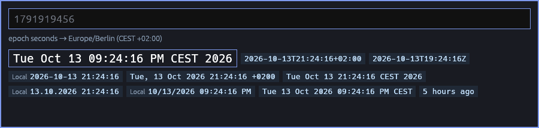

# Epochup

Popup app to quickly and flexible convert between UNIX epoch and datetime. Press enter to copy the suggestion to clipboard. THAT'S ALL THERE IS!



Uses your default locale as the date format, otherwise it also supports reading in English, German, Dutch, Spanish, Portuguese, French, Italian, Polish, Russian, Thai, Japanese, Korean, Chinese.

It tries to be smart about it. It will check your clipboard if it can match any dates found there, and immediately suggest the date found (if any).

An entered epoch value will suggest date formats, an entered date will suggest epoch format. SIMPLE and FAST.

## What it reads

- **Epochs** in seconds, milliseconds, microseconds or nanoseconds: integers, floats, `1.79e9`, `@1791919456`.
- **Machine formats**: ISO 8601, RFC 2822, ctime, syslog, Apache logs, Go and Python timestamps, dates inside JSON.
- **Relative and org-mode input**: `fri`, `+3d`, `-wed`, `w42`, `next friday 3pm`, `in 2 hours`, `3 days ago`.
- **Languages**: English, German, Japanese, Chinese, Korean, Russian, Polish and Thai, plus month names in French, Spanish, Italian, Dutch and Portuguese.
- **Text**: the first date in a paste is found, highlighted, and its language named.

Ambiguous input shows its other readings: `03/04/2026` both ways, a local time also as UTC.

## Use

| Key         |                                      |
| ----------- | ------------------------------------ |
| Enter       | Copy the highlighted value and close |
| Arrows, Tab | Pick another value                   |
| Alt+1…9     | Copy that value and close            |
| Esc         | Close without doing anything         |

`epochup TEXT` opens with TEXT typed in. `epochup -e TEXT` prints the conversion instead.

## Install

```sh
cargo install --path .
```

Built for Linux, and tested on Wayland with sway:

```
for_window [app_id="epochup"] floating enable, sticky enable, resize set 900 230
bindsym $mod+u exec ~/.cargo/bin/epochup
```

Chinese, Japanese, Korean and Thai text needs Noto Sans CJK and Noto Sans Thai installed.

## Configure

Colors can be changed in `~/.config/epochup/config.toml`. Copy [config.toml.example](config.toml.example), which lists every color with its default, and keep only what you change.
